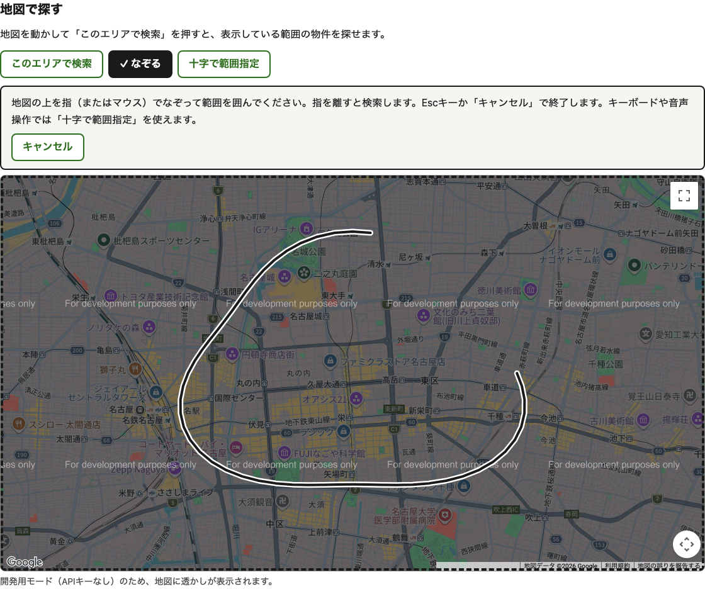
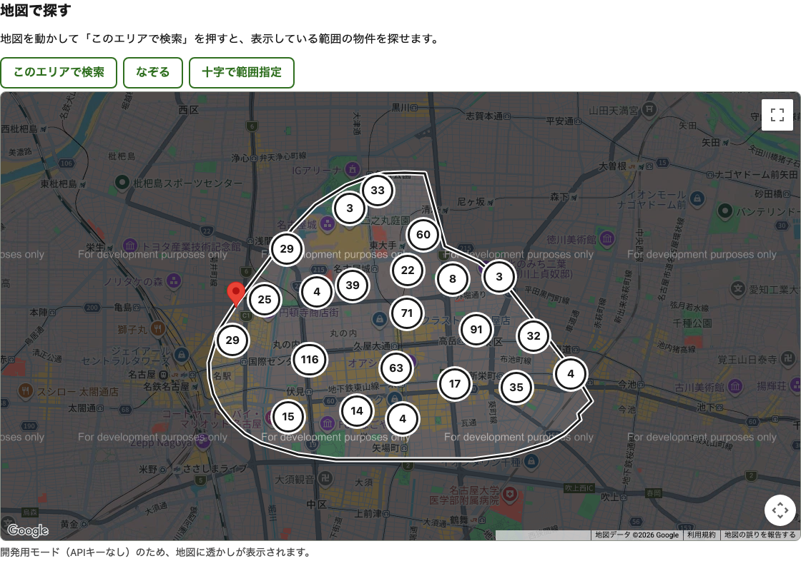
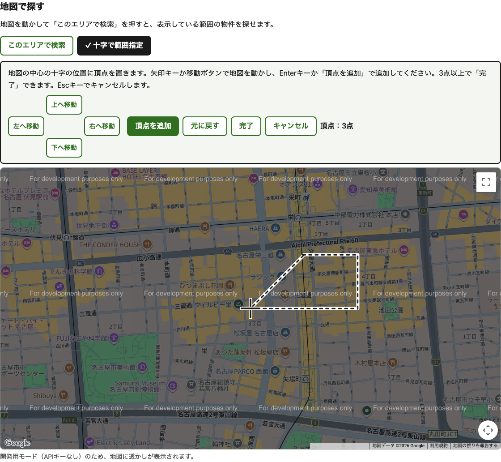

# なぞる area search — SEO-forward, accessible web PoC

A proof of concept for property search on the web: a finger-traced ("なぞる") map area search built with **Astro 7** and **Google Maps JS**, that is also **SEO-first** and targets **WCAG 2.2 AA**. All data is synthetic, covering central Nagoya.

- Spec: [SPEC.md](SPEC.md) · Plan, spike results and deviations: [PLAN.md](PLAN.md)
- Background research: `../reports/Freehand map area search.md` and `../reports/Freehand map area search accessibility.md`

| Trace (なぞる) | Result | Crosshair (keyboard, voice, switch) |
|---|---|---|
|  |  |  |

## Quick start

```bash
pnpm install
pnpm dev                    # http://localhost:4321/nagoya/  (reads .env; route cache is inactive in dev)
pnpm build && pnpm preview  # production build with the in-memory route cache
pnpm check                  # astro check (types)
pnpm test:unit              # Vitest: area model, geometry, data
pnpm test:e2e               # Playwright + axe against a fresh build (keyless Maps; needs network)
```

No local setup? [Open it in CodeSandbox](https://codesandbox.io/p/devbox/github/allenthich/prototype-maps-nazoru); the root README has the details.

**Maps API key.**
- Put it in `.env` as `GOOGLE_MAPS_API_KEY`, alongside `GOOGLE_MAPS_MAP_ID`, which defaults to `DEMO_MAP_ID`. `.env` is gitignored.
- Without a key the map runs in Google's **keyless development mode**: tiles are darkened and watermarked, and Google shows a dismissible dialog.
- The key is read **at runtime**, so it is never baked into a build. `node dist/server/entry.mjs` only sees the process environment.
- E2E tests always run keyless unless `E2E_GOOGLE_MAPS_API_KEY` is set.
- A Maps JS key always ends up in HTML, so **restrict it by HTTP referrer** in Google Cloud Console.

## Architecture

```
                 ┌──────────────── one area model (src/core/area) ───────────────┐
 producers       │ stations · wards · radius · bounds · polygon(trace|crosshair)  │  URL-serialised
 ───────────     └───────────────────────────────┬───────────────────────────────┘
 GET forms (no JS)        ─┐                      │
 「このエリアで検索」       ─┤  area-change event   ▼
 十字で範囲指定 (crosshair) ─┤ ─────────────▶  /nagoya/search/?…            full page (noindex)
 なぞる (trace)            ─┘                   /nagoya/search/results/?…    HTML partial (same ResultList)
                                               /nagoya/search/points.json?… cluster points + outline
                                                       │
                                     searchListings(area) ← one filter, so list and clusters always agree
```

- **`src/core/`** is framework-agnostic TypeScript with no DOM and no Astro imports:
  - URL round-trip
  - polygon validation with Japanese messages
  - point-in-area tests
  - text summaries (the WCAG 1.1.1 text alternative)
  - outlines, stroke clean-up and the encoded polyline format
- **`src/widget/`** is `<nazoru-map>`, a light-DOM custom element in plain TypeScript.
  - The host server-renders its markup and the element adds behaviour, so it can move to another stack unchanged.
  - Maps JS and clustering load in a separate chunk, only when the widget is visible and the browser is idle, or on first interaction.
  - It talks to the page only through DOM events (`area-change` out, `search:results` in) and `data-*` attributes.
- **`src/client/search-controller.ts`** (about 2 KB) progressively enhances the search page. Forms, pagination and Back/Forward swap the server-rendered results partial in place, update history, and announce once.
- **`src/pages/`** holds the Astro routes. Ward, station and listing pages use the `routeRules` cache (`X-Astro-Cache: HIT` on repeat requests).

## SEO model

| Route | Indexing | Notes |
|---|---|---|
| `/nagoya/`, `/nagoya/ward/[ward]/`, `/nagoya/station/[station]/` | index, self-canonical, `?page=n` pagination | One `<h1>`, breadcrumbs, BreadcrumbList + ItemList JSON-LD, cached |
| `/listings/[id]/` | index | `RealEstateListing` + `Apartment` + `Offer` JSON-LD; **no client JS** |
| `/nagoya/search/?…` | `noindex, follow`, no canonical | User-defined shapes are effectively unlimited, so they aren't indexed |
| `/nagoya/search/results/`, `points.json` | `X-Robots-Tag: noindex` | Never linked |
| `/sitemap.xml`, `/robots.txt` | — | Custom endpoint, because `@astrojs/sitemap` can't list on-demand routes |

**Page speed:** the map's space is reserved with `aspect-ratio`, so loading it shifts nothing. The heading and list are the largest content painted first, and Maps JS is never requested before the widget is visible.

## Accessibility

Two principles drive the design:
- **The list comes first and the lasso last.** Every area search works without JS, without a pointer and without the map.
- **Tracing is a shortcut, not the only route.** WCAG 2.1.1, 2.5.1 and 2.5.7 require a non-path, non-drag way to get the same result. That is the crosshair mode plus the station, ward and radius lists.

| Concern | What the PoC does |
|---|---|
| Keyboard / voice / switch drawing | Crosshair mode. Arrow keys or a visible pan pad pan the map; **Enter** or 「頂点を追加」 adds a vertex; Backspace, Ctrl/Cmd+Z or 「元に戻す」 undoes; 「完了」 finishes; **Esc** or 「キャンセル」 leaves. No dragging anywhere |
| Gesture conflicts | Trace mode is an explicit `aria-pressed` toggle that sets `gestureHandling: 'none'` only while tracing, plus a `touch-action: none` overlay. Keyboard panning is never disabled |
| Pointer cancellation (2.5.2) | Esc or `pointercancel` aborts a stroke; releasing outside the map discards it; a second finger aborts instead of guessing |
| Errors (3.3.1/3.3.3) | Japanese messages for too few vertices, crossing lines, too small or too large shapes, in a `role="alert"`. The previous area is kept |
| Status messages (4.1.3) | One polite `role="status"` region, present from load and debounced, e.g. 「栄駅の物件は82件です。」 |
| Clusters | `AdvancedMarkerElement` + `gmpClickable` with Japanese names (「N件の物件。選択すると拡大します」). Enter zooms in, focus returns to the map, and the result is announced. Markers are keyed so focus survives re-renders |
| Contrast (1.4.11) | The surroundings are dimmed and the area gets a white casing under a dark stroke. Cluster bubbles have dark rings and white halos. All of this survives forced-colors mode |
| Other | Skip link past the map (2.4.1); 44 px targets; reflow at 320 px; reduced motion (pan pad jumps instead of animating); Street View pegman removed because it is drag-only; the pressed-toggle checkmark is CSS alt-text `''`, so it stays out of the accessible name |

**Automated coverage** (`tests/e2e/`): 46 Playwright tests.
- **Approach:** axe scans of every page and mode; keyboard-only and pointer-only crosshair runs; mouse and **real touch (CDP)** trace runs.
- **What they check:** list/cluster parity, focus placement, live-region text, no-JS forms, SEO tags, the sitemap and cache hits.
- They don't replace the manual matrix below.

### Manual test matrix (not yet run)

| Environment | Focus |
|---|---|
| NVDA (Japanese) + Chrome/Firefox, JAWS + Chrome, PC-Talker + Edge | Browse vs focus mode on Google's map region; crosshair flow; announcements |
| VoiceOver iOS Safari, TalkBack Android Chrome | Trace on real touch hardware; rotor/headings; cluster buttons |
| iOS Voice Control, Android Voice Access, iOS Switch Control | 「タップ 頂点を追加」, pan pad, 完了: these users cannot trace at all |
| Keyboard only, 200%/400% zoom, Windows High Contrast | Focus visibility, reflow, overlay visibility |

## Production path

- **Data:** replace `src/data/listings.server.ts` with PostGIS, keeping `searchListings(area)` as the seam:
  `WHERE ST_Intersects(location, ST_GeomFromGeoJSON($1)::geography)` with a GiST index. Counts per grid cell or per ward can be computed server-side.
- **Caching:** swap `memoryCache()` for an Astro CDN cache provider (Netlify, Vercel or Cloudflare; these are experimental in Astro 7), and invalidate the `listings` tag on data changes.
- **Places:** if results ever come from Google Places, radius search becomes the main mode. Polygon counts come from the Places Aggregate API. Store only place IDs.
- **Walking-time areas:** Google's Isochrones API is in Preview and has no transit mode. Its polygon would feed the same `polygon` pipeline.
- **Stack:** `src/core` and `src/widget` don't depend on Astro. Porting means re-implementing the pages and the results partial.

## Known gaps and caveats

- **Data:** station coordinates and ward assignments are approximate. Listings are synthetic, and each listing's ward is its nearest station's ward.
- **Back button:** Back/Forward restores the results but not the checkbox state of the forms.
- **Trace mode:** after an invalid shape, trace mode stays on so the user can redraw immediately; the map can't be panned until they exit.
- **Clustering:** I chose `supercluster` over `@googlemaps/markerclusterer`. The latter has had no release since July 2025, and its default clickability relies on a deprecated listener path.
- **Untested:**
  - real iOS Safari and Android devices
  - screen readers (see the matrix above)
  - Google Maps behaviour under forced colors beyond our own overlays
  - the polygon behaviour of Places APIs
- **Keyless mode:** the axe scans exclude only Google's keyless-mode dialog.
